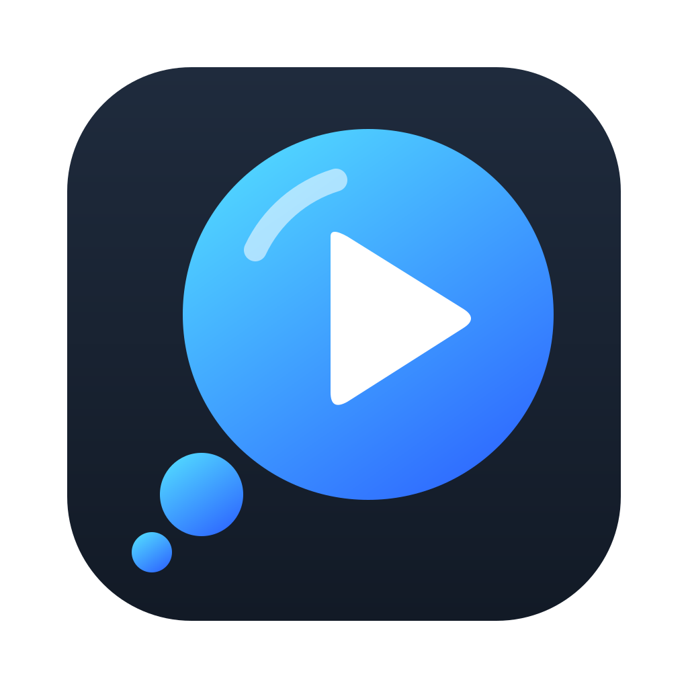
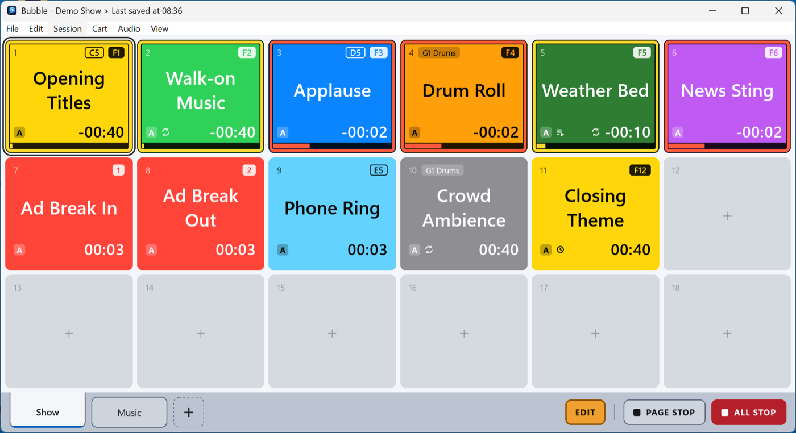
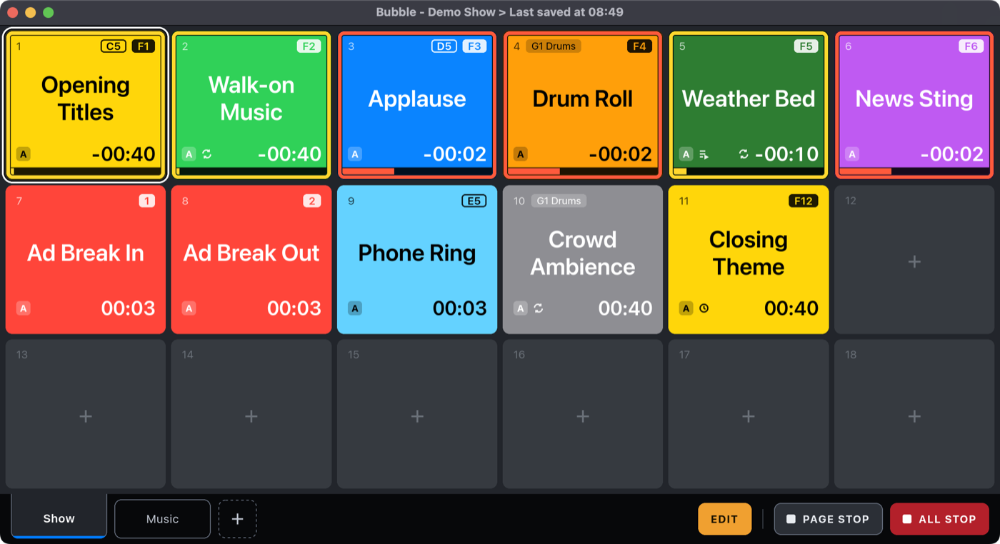
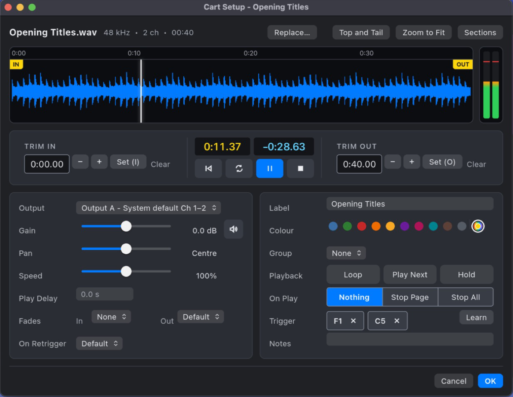
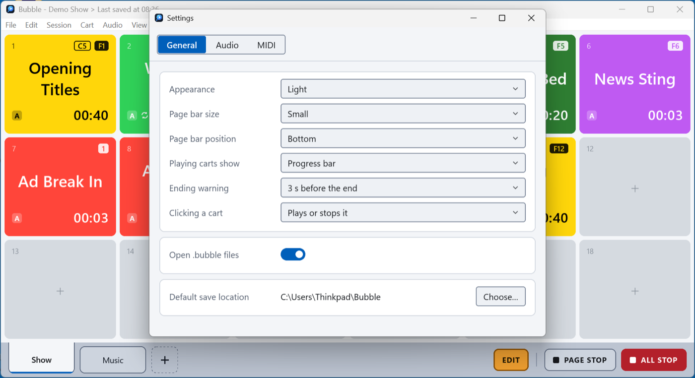

<p align="center">
  
</p>

<h1 align="center">Bubble</h1>

<p align="center">
  A cart player for live playout on Windows and macOS.<br>
  Named for the director's call for "bubble".
</p>

<p align="center">
  <a href="../../releases/latest"><b>Download</b></a> ·
  <a href="docs/user-guide.md">User guide</a> ·
  <a href="docs/decisions.md">Design decisions</a>
</p>

<table>
  <tr>
    <td></td>
    <td></td>
  </tr>
  <tr>
    <td align="center">Windows</td>
    <td align="center">macOS</td>
  </tr>
</table>

Bubble plays audio from a wall of carts, from a mouse, a touch screen, hot keys or MIDI.
It is built for shows that cannot stop: a trigger never waits for the disk, and a lost
audio device or a crash costs as little as possible. It opens SpotOn sessions and
packages, so an existing show moves across as it is.

## Features

- **Cart wall:** pages of carts with colours, groups, hot keys and MIDI notes. Playing
  carts show a ring and a progress bar (or a clock, or just the countdown) that read on
  any colour.
- **Cart Setup:** waveform, trims, Intro/Main/Outro sections, fades, gain, pan, speed and
  play delay. Times can be typed, pasted or set at the playhead.
- **Starts at once:** short files play from memory, and long ones stream from disk behind
  a few seconds held in memory.
- **Formats:** WAV, AIFF, FLAC, MP3, AAC/M4A, ALAC and Ogg Vorbis.
- **Several outputs:** stereo pairs, mono channels or 5.1, across one or more devices,
  Dante Virtual Soundcard included. A lost device falls back to the system output and
  returns when it is back.
- **Self-contained sessions:** a session is a folder holding its audio, so it can be
  copied, backed up or handed to another computer, Windows or Mac.
- **Safe:** autosave every 30 seconds with recovery after a crash, backups of earlier saves, a
  Playout Log, and Show mode to lock the wall during a show.
- **SpotOn import:** sessions (`.dta`) and packages (`.pkg`) open as new sessions, or are
  added to the one open, with a report of anything that needs a look.

## Getting started

1. Download the zip for your computer from [Releases](../../releases/latest) and unzip it.
   - **Windows:** run `Bubble.exe` (x64 for Intel and AMD, arm64 for Windows on ARM).
     The app is not signed, so SmartScreen asks first: More info, then Run anyway.
   - **macOS:** Control-click Bubble and choose Open the first time. The app is not signed.
2. Choose File ▸ New Session…, or open a Bubble or SpotOn session with File ▸ Open….
3. Drop audio files onto the wall, and click a cart to play it.

Settings ▸ Audio sets up outputs; the [user guide](docs/user-guide.md) covers the rest.

<table>
  <tr>
    <td></td>
    <td></td>
  </tr>
  <tr>
    <td align="center">Cart Setup</td>
    <td align="center">Settings</td>
  </tr>
</table>

## Good to know

- On Windows, Bubble sets each output device it uses to its mixer rate (48 kHz by
  default, or 44.1 kHz) so that Windows does not convert the audio again. This changes
  the device's default format for every app, and it stays after Bubble quits.
- Every push to `main` is built for Windows and macOS and published as the **Test build**
  pre-release, for testing only.

## Building from source

Rust 1.90 or later:

```bash
cargo run --release -p bubble-slint
```

[crates/bubble-slint](crates/bubble-slint/README.md) covers the interface, test aids and
cross-building for Windows; [platform status](docs/platform-status.md) says what has
been tested where.

## Licence

Bubble's interface is made with [Slint](https://slint.dev), and Bubble is built on many
other open-source libraries: see [Acknowledgements](docs/acknowledgements.md).

Bubble is free software: you can redistribute it and/or modify it under the terms of the
GNU General Public License as published by the Free Software Foundation, either version 3
of the License, or (at your option) any later version. See [LICENSE](LICENSE).
